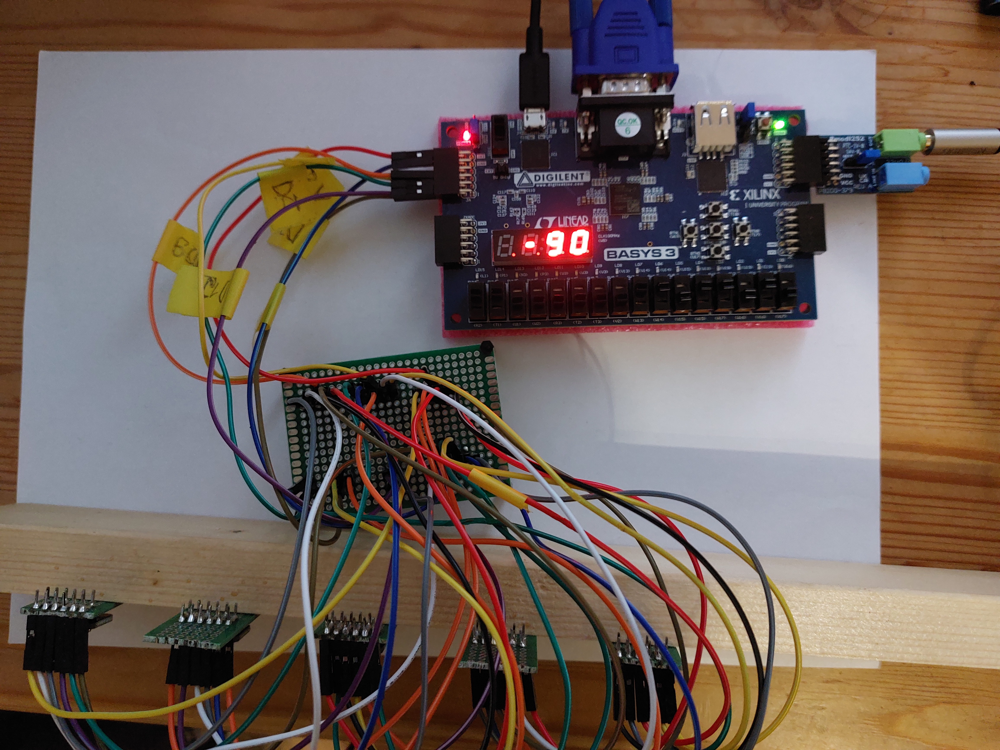
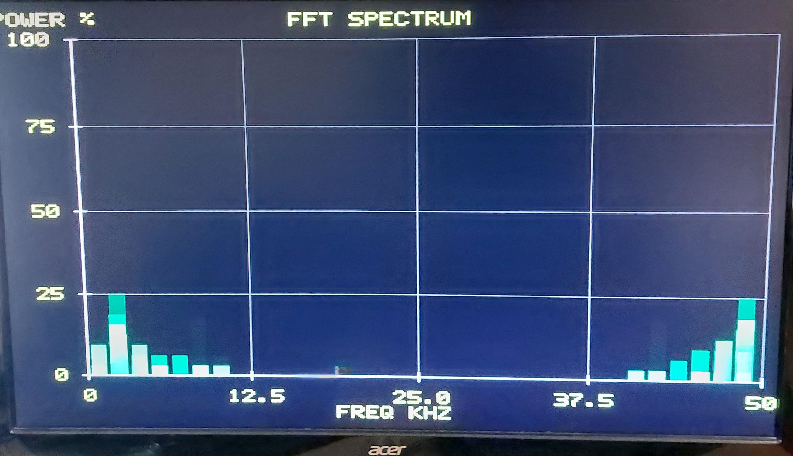
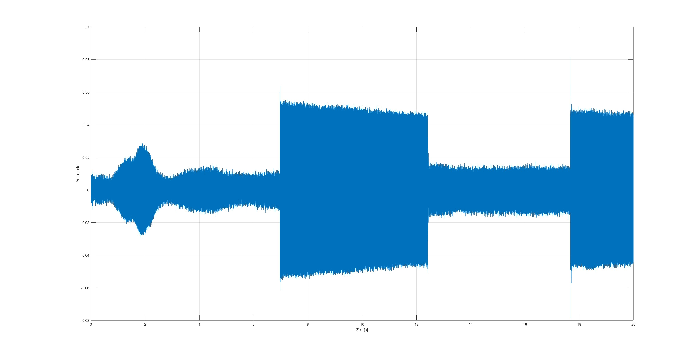

# FPGA-Audio-Beamforming
Project files for real-time digital audio beamforming on FPGA Basys 3 board, developed during Digital Systems class at HAW Hamburg in a team of two.

## Repository Structure
```
.
├── Blockdiagrams/     Block diagrams for all VHDL modules
├── Constraints/       Basys 3 pin constraints (.xdc)
├── Results/           Beamformed audio, array setup photos, VGA spectrum
├── Scripts/           Python/Matlab scripts for twiddle factors and delay tables
├── Simulation/        Testbenches for simulation
├── Sources/           VHDL source files
├── LICENSE
└── README.md
```

---


## Goal
Our goal was to implement and verify delay-and-sum (DAS) beamforming for audio signals picked up by a self-made linear microphone array. We defined success as: signals from the intended direction measurably amplified (or at least less attenuated) compared to other directions, verified either aurally or through the FFT spectrum.  
  
The workload was split into two parts:  
  
**My contribution:**
- Angle-to-delay lookup table
- Delay-and-sum algorithm (ring buffer, RAM, summation)
- 32-point parallel-pipelined FFT

**Project partner:**
- I2S transceiver (timing, receivers, transmitter)
- VGA spectrum display


## Architecture

`Top_Beamformer_Analysis` is the top module that ties everything together. It contains
`Top_Beamformer` (DAS algorithm + I2S transceiver) and the two verification modules
`FFT_TOP` and `VGA_TOP`. Additional block diagrams for submodules are in `Blockdiagrams/`.

### Top_Beamformer_Analysis
<p align="center">
  
</p>

#### `FFT_TOP`
- Parallelizes incoming DAS audio from `Top_Beamformer`
- Performs the FFT
- Outputs the magnitude spectrum
- Uses a custom library for complex number types and operations

#### `VGA_TOP`
- Live display of the magnitude spectrum

### Top_Beamformer
<p align="center">
  
</p>

#### `clk_wiz_I2S`
- Clocking wizard IP block to generate the appropriate clock
- All systems use it to avoid CDC issues

#### `i2s_top_5mic`
- Transceiver module for the microphones
- Receives digital data
- Outputs 24-bit audio from each mic to the DAS algorithm
- Outputs the DAS result to the I2S Pmod

#### `delay_and_sum`
- Implementation of the DAS algorithm
- Delays realized with ring buffers

#### `Angle_To_Delay`
- Translates the requested angle into a delay for each microphone
- Angle entered as a binary number via Basys 3 switches

#### `Seven_segment_display`
- Displays the requested beamforming angle (−90° to 90°)
 

 
## Specification

### Linear Microphone Array


<p align="center">
  
</p>

| | |
|---|---|
| **Microphones** | 5 × digital MEMS (ICS43434, Adafruit ADA6049) |
| **Geometry** | Linear, 4 cm spacing |
| **Target frequency** | 4 kHz (speech band, λ ≈ 8.6 cm) |
| **Spacing condition** | d ≤ λ/2 (no grating lobes) |
| **Sampling rate** | 50 kHz |
| **Beam steering** | −90° to +90°, 11 discrete angles with integer-sample delays |


### FFT

| | |
|---|---|
| **Type** | Radix-2 DIT, Cooley–Tukey |
| **Points** | 32 |
| **Architecture** | Parallel-pipelined |
| **Word length** | 8-bit, fixed-point 1Q7 |
| **Frequency resolution** | 1.5625 kHz |


### I2S
24-bit audio at 50 kHz over a standard I2S bus (3.2 MHz BCLK, 64-BCLK stereo frames)


## Conclusion and Results

To sum up, we successfully implemented the delay-and-sum algorithm for audio beamforming. We also added visual and aural verification on the FPGA, confirming that the beamformer works. The results are shown below.

The first image shows the FFT spectrum rendered on the VGA display. The second shows the measured audio amplitude when the beamforming angle was switched from 90° to −90°, demonstrating the directional response of the array.

<p align="center">
  
  
</p>

Despite achieving a usable audio beamforming platform, several aspects can be improved.

The FFT works and is usable for verification, but it is far from optimal. The fully parallel-pipelined architecture is well suited to high-data-rate applications and was chosen for its simplicity of implementation, but it consumes a large amount of FPGA resources. Our application does not need those data rates — it is limited by a slow source (I2S receiver, f_s = 50 kHz) and a slow consumer (VGA monitor, 60 fps). A possible improvement is an in-place butterfly calculation, which would reduce resource usage at the cost of longer computation time.

Other improvements we considered include comparing our implementation against the Vivado FFT IP block, streaming FFT results to a PC over USB for deeper analysis, and adding a waterfall plot to the VGA display.
